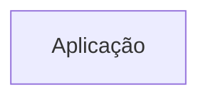
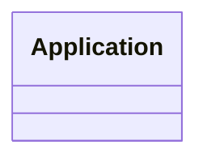
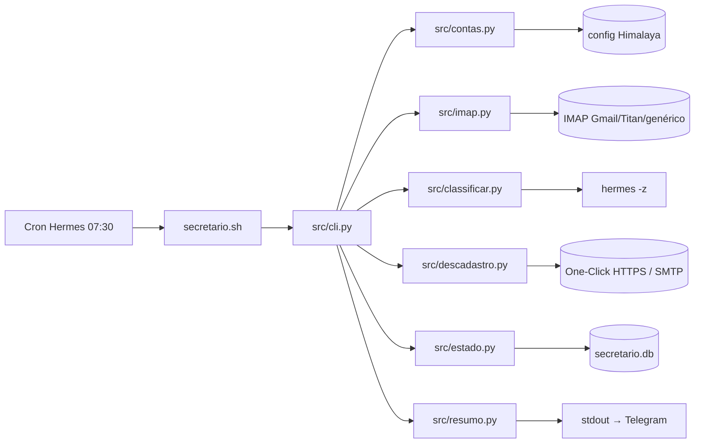

# Arquitetura

<!-- specsfy:documentator:start -->
Os diagramas são exemplos de formato. Eles não representam relações confirmadas da aplicação.

## Componentes

| Tipo | Quantidade |
| --- | --- |
| Código | 23 |
| Testes | 12 |

## Diagramas

<!-- specsfy:documentator:end -->

## Módulos (escrito à mão)

| Arquivo | Responsabilidade |
| --- | --- |
| `bin/secretario` → `src/cli.py` | Subcomandos; orquestra a faxina por conta (falha de uma conta não para as outras) |
| `src/contas.py` | Lê contas do Himalaya; presets por provedor (porta, ssl/starttls); cadastro testando IMAP e SMTP |
| `src/imap.py` | Conexão, novos por UID, rótulo (`X-GM-LABELS` no Gmail, pasta no IMAP genérico), arquivar, lido, lixeira por atributo `\Trash` |
| `src/classificar.py` | Regras → proteções embutidas → palavras/cabeçalhos → IA em lote (máx. 20 chamadas de 100), saída fechada |
| `src/descadastro.py` | Só One-Click (RFC 8058) ou `mailto:` |
| `src/resumo.py` | Texto do resumo, do ensaio e do plano das segundas |
| `src/estado.py` | SQLite, migrations e retenção |
| `src/instalar.py` | Script, skill e cron no Hermes |

