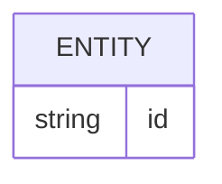
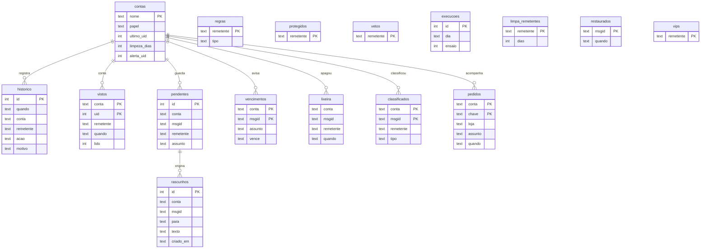

# Banco de dados

<!-- specsfy:documentator:start -->
Os diagramas são exemplos de formato. Eles não representam relações confirmadas da aplicação.

## Fontes de persistência

| Arquivo |
| --- |
| migrations/001_inicial.sql |
| migrations/002_limpeza.sql |
| migrations/003_limpa_remetentes.sql |
| migrations/004_extras.sql |
| Nenhuma estrutura confirmada além das fontes listadas. |

<!-- specsfy:documentator:end -->

## Diagrama (escrito à mão)

Detalhes e retenção em `.specsfy/DATABASE.md`.

