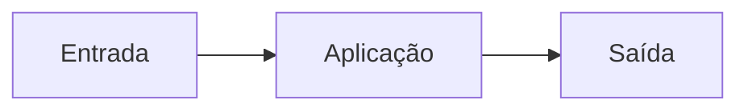
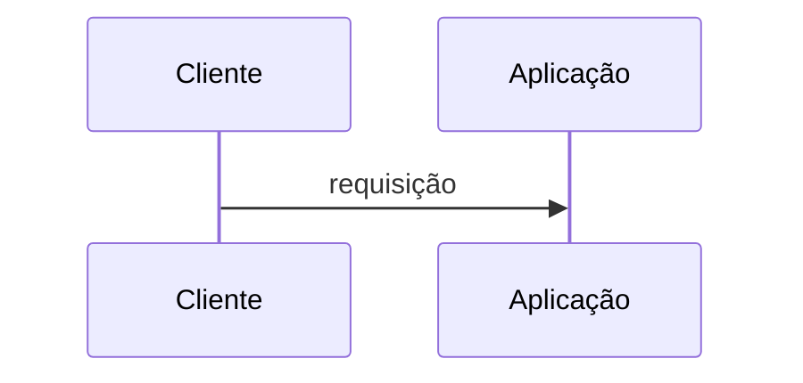

# Fluxos

<!-- specsfy:documentator:start -->
Os diagramas são exemplos de formato. Eles não representam relações confirmadas da aplicação.

## Fluxo principal




<!-- specsfy:documentator:end -->

## Faxina diária (escrito à mão)

```mermaid
sequenceDiagram
  participant H as Hermes cron
  participant S as secretario faxina
  participant I as IMAP
  participant A as IA (hermes -z)
  H->>S: 07:30 BRT
  loop cada conta
    S->>I: SEARCH UID > último; FETCH cabeçalhos + 2 KB do texto
    S->>S: regras, proteções, palavras, cabeçalhos
    S->>A: só os em dúvida (remetente, assunto, 300 caracteres)
    alt ensaio (primeira execução)
      S->>S: só conta o que faria
    else real
      S->>I: rótulo, lido, arquivar, lixeira (\Trash)
      S->>S: One-Click/mailto para quem nunca abre
    end
  end
  S-->>H: resumo no stdout → Telegram
```
